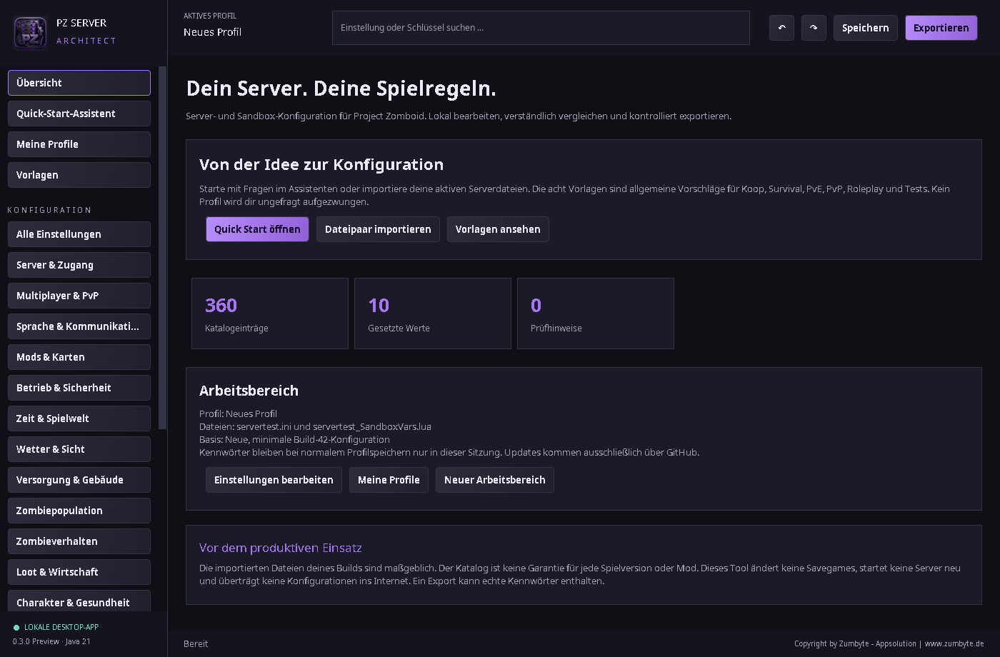
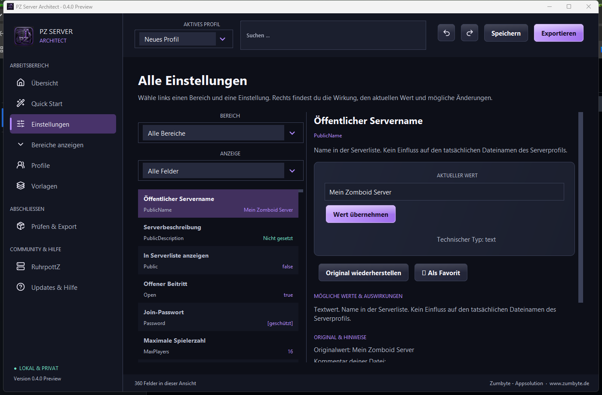

<p align="center"></p>
<h1 align="center">PZ Server Architect</h1>
<p align="center">Dein Project-Zomboid-Server. Deine Regeln.<br>Ein lokaler Konfigurator für verständliche Serverwerte, Profile und einen sicheren Export.</p>

<p align="center">
  <a href="https://github.com/ZUMBYTE-AppSolution/ruhrpottz-serverconfig-tool/releases/download/v0.3.0/PZ-Server-Architect-0.3.0-windows-x64.msi"><strong>Windows installieren</strong></a>
  · <a href="https://github.com/ZUMBYTE-AppSolution/ruhrpottz-serverconfig-tool/releases/download/v0.3.0/PZ-Server-Architect-0.3.0-windows-x64-portable.zip">Windows portabel</a>
  · <a href="https://github.com/ZUMBYTE-AppSolution/ruhrpottz-serverconfig-tool/releases/latest">Alle Plattformen</a>
</p>
<p align="center">
  <a href="https://github.com/ZUMBYTE-AppSolution/ruhrpottz-serverconfig-tool/releases"></a>
  <a href="https://github.com/ZUMBYTE-AppSolution/ruhrpottz-serverconfig-tool/actions/workflows/ci.yml"></a>
  <a href="CHANGELOG.md"></a>
</p>

> **Öffentlich verfügbar:** v0.3.0 Preview für Windows x64, macOS Intel und Apple Silicon sowie Linux x64. Die neue Oberfläche v0.4.0 hat die private Plattformprüfung bestanden und steht hier als Teststand bereit. Die App verändert keinen laufenden Server.



## Was du damit machen kannst

| Aufgabe | In der App |
|---|---|
| **Schnell starten** | Neun Fragen und acht neutrale Vorlagen mit Änderungsvorschau. |
| **Werte verstehen** | 360 erklärte Katalogeinträge in 17 Bereichen sowie importierte Modfelder. |
| **Gezielt bearbeiten** | Suche, Bereichsauswahl, Favoriten, passende Schalter und Auswahlfelder, Undo und Redo. |
| **Profile behalten** | Lokal speichern, kopieren, umbenennen, wiederherstellen und als JSON übertragen. |
| **Dateien sicher übernehmen** | INI und Sandbox-Lua importieren, prüfen und als neues ZIP exportieren. |
| **Updates finden** | GitHub-Releases prüfen und passende Pakete nach Prüfsummenvergleich laden. |

Es gibt keinen Masterserver, keine Telemetrie und keinen Upload deiner Serverkonfiguration. Der RuhrpottZ-Eintrag ist ein separater, manuell abrufbarer Community-Tipp.

## Installation

1. Lade das passende Paket von den [Releases](https://github.com/ZUMBYTE-AppSolution/ruhrpottz-serverconfig-tool/releases). Windows bietet MSI und ein portables ZIP, macOS je ein DMG für Intel und Apple Silicon, Linux ein DEB und ein portables TAR.GZ.
2. Bei einem portablen Paket: **vollständig entpacken**, dann den enthaltenen App-Starter öffnen. Die Java-Laufzeit ist enthalten.
3. Importiere dein zusammengehöriges `.ini`- und `_SandboxVars.lua`-Dateipaar oder beginne mit Quick Start.
4. Prüfe die Änderungen und exportiere ein neues ZIP. Übernimm es erst nach einem Backup und einem Test mit deinem Spielbuild und deinen Mods.

Das MSIX-Testpaket aus dem Entwicklungsbuild ist derzeit **nicht signiert** und verwendet eine Entwicklungsidentität. Für eine Store-Abgabe fehlen noch die Reservierung und Paketidentität aus Microsoft Partner Center. Das Windows-ZIP ist sofort startbar; der MSI-Installer des öffentlichen v0.3.0-Releases ist ebenfalls verfügbar. [MSIX-Stand](docs/RELEASES.md)



## Hinweise zu deinen Daten

Profile bleiben auf deinem Gerät. Erkannte Passwortfelder werden beim normalen Profilspeichern nicht dauerhaft übernommen. Ein exportiertes Server-ZIP kann dennoch echte Zugangsdaten enthalten; prüfe es vor dem Teilen. Die App führt kein Lua aus, ändert keine Savegames und startet keine Server neu. Details stehen im [Handbuch](src/main/resources/HANDBUCH.md) und in [Sicherheit](SECURITY.md).

Der Katalog hilft bei der Bedienung, ersetzt aber keinen Test mit deiner konkreten Project-Zomboid-Version und Modkombination. AMP kann Werte beim Serverstart überschreiben.

## Entwicklungsstand

Der öffentliche Stand v0.3.0 wurde in [vier Plattformjobs](https://github.com/ZUMBYTE-AppSolution/ruhrpottz-serverconfig-tool/actions/runs/38703376018) gebaut und als [Preview-Release](https://github.com/ZUMBYTE-AppSolution/ruhrpottz-serverconfig-tool/releases/tag/v0.3.0) veröffentlicht. Die neue v0.4.0-Oberfläche und das MSIX-Paket haben den [privaten Plattformlauf](https://github.com/ZUMBYTE-AppSolution/ruhrpottz-serverconfig-tool-dev/actions/runs/38710901694) bestanden. Bestätigte Ergebnisse und offene Punkte stehen in [Prüfstatus](docs/TESTSTATUS.md) und [Changelog](CHANGELOG.md).

Für Entwicklung werden JDK 21 und Python 3 benötigt:

```sh
python tools/build.py
python tools/package.py --installer
```

Die Pakete werden jeweils auf ihrem Zielbetriebssystem erstellt. GitHub Actions baut Windows, macOS und Linux automatisch; ein Versionstag auf `main` erstellt erst nach vollständiger Paket- und SHA-256-Prüfung ein Release. Der private Entwicklungsstand liegt in einem separaten Repository mit Branch `test`, weil GitHub keine privaten Branches innerhalb eines öffentlichen Repositorys anbietet. [Release-Ablauf](docs/RELEASES.md) · [Mitwirken](CONTRIBUTING.md)

## Hilfe und Kontakt

[Handbuch](src/main/resources/HANDBUCH.md) · [Probleme melden](https://github.com/ZUMBYTE-AppSolution/ruhrpottz-serverconfig-tool/issues) · [Support](SUPPORT.md) · [Zumbyte](https://www.zumbyte.de/)

PZ Server Architect ist ein eigenständiges Projekt von Zumbyte - Appsolution und steht nicht in Verbindung mit The Indie Stone. Die Veröffentlichung des Quellcodes erteilt derzeit keine zusätzliche Nutzungslizenz.
