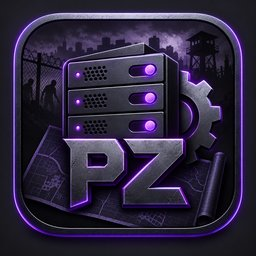

<p align="center">
  
</p>

<h1 align="center">PZ Server Architect</h1>

<p align="center">
  Dein Server. Deine Spielregeln.<br>
  Ein lokaler Desktop-Konfigurator für Project Zomboid mit verständlichen Werte-Hilfen,<br>
  eigenen Profilen und einem geführten Einstieg. Von <strong>Zumbyte - Appsolution</strong>.
</p>

<p align="center">
  <a href="../../actions/workflows/ci.yml"><strong>📦 Builds &amp; Pakete</strong></a>
  · <a href="../../releases">📝 Releases</a>
  · <a href="src/main/resources/HANDBUCH.md">📖 Handbuch</a>
  · <a href="CHANGELOG.md">Was ist neu?</a>
</p>

<p align="center">
  
  
  
  
</p>

---

## ✨ Was PZ Server Architect ausmacht

Survival mit vielen Zombies, entspannte Koop-Runden, PvE, PvP oder Roleplay: Du legst die Richtung fest. Die App ist nicht auf einen bestimmten Server oder eine Welt ohne Zombies zugeschnitten.

- **Einstellungen mit Bedeutung:** 360 Katalogeinträge in 17 Bereichen mit technischem Schlüssel, Beschreibung, bekannten Auswahlwerten, Grenzen, Einheiten und Originalkommentaren. Zusätzliche Modfelder werden aus importierten Dateien erkannt. Unbekannte Wirkungen bleiben als unbekannt gekennzeichnet.
- **Die richtige Eingabe für jeden Wert:** Echte Ein/Aus-Felder erhalten Toggle-Switches. Mehrfachauswahlen bleiben Dropdowns, Zahlen bleiben Zahlen. `Nicht gesetzt`, `false` und `0` werden nicht miteinander verwechselt; dokumentierte numerische Schalter behalten ihre 0/1-Schreibweise.
- **Quick Start statt Ratespiel:** Neun Fragen führen zu passenden Vorschlägen. Vor der Übernahme zeigt die App genau, welche Werte sich ändern.
- **Acht neutrale Vorlagen:** Koop & Freunde, PvE Community, ausgewogenes Survival, Hardcore, PvP, Roleplay mit Zombies, ziviles Roleplay und Bau-/Testwelten. Zugangsdaten, Modlisten und Kartenreihenfolgen werden nicht ungefragt ersetzt.
- **Eigene Profile:** Speichern, öffnen, kopieren, umbenennen, löschen und aus dem Papierkorb wiederherstellen. Pro Profil bleiben zehn ältere Fassungen erhalten. JSON-Import/-Export und bis zu 40 Undo-/Redo-Schritte ergänzen den Arbeitsbereich.
- **Dateien kontrolliert bearbeiten:** Server-INI und Sandbox-Lua gemeinsam importieren, Änderungen mit dem Original vergleichen und als neues Server-ZIP exportieren. Unterstützte Kommentare und Reihenfolgen bleiben erhalten. Der Parser führt keinen Lua-Code aus.
- **Deine Arbeit bleibt lokal:** Profile liegen außerhalb der App-Installation. Erkannte Kennwortfelder werden standardmäßig nicht dauerhaft mitgespeichert. Ein Export schreibt nicht direkt auf deinen Spielserver.
- **Updates über GitHub:** Automatische Prüfung beim Start, verifizierter Download, Fortschritt und Versionshinweise. Die Installation ist eine gesonderte Aktion nach gesichertem Arbeitsstand. Kein Masterserver und kein GitHub-Token für Endnutzer.
- **Graphit, Lila und ein eigenes App-Icon:** Die bestehende Gestaltung bleibt erhalten, einschließlich Sidebar, Glow und skalierbarer Bedienoberfläche. Die Anwendung verwendet Swing und benötigt keinen Browser und kein JavaFX.

> [!IMPORTANT]
> **0.3.0 ist eine Preview.** Die gebaute Desktop-App ersetzt nicht den Spieltest mit deinem konkreten Zomboid-Build und deinen Mods. Nicht alle Kataloggrenzen sind für jeden Build vollständig verifiziert. [Prüfstand und bekannte Grenzen](docs/TESTSTATUS.md).

## 🚀 Starten und Pakete auswählen

Die [Buildübersicht](../../actions/workflows/ci.yml) enthält die Ergebnisse der tatsächlich gelaufenen GitHub-Builds. Am Ende eines erfolgreichen Laufs stehen dessen Pakete unter **Artifacts** bereit; GitHub kann dafür eine Anmeldung verlangen. Öffentlich freigegebene Dateien gehören auf die [Releases-Seite](../../releases). Ein grüner Build ist noch keine stabile Veröffentlichung.

| Ausgabe | Start | Java separat nötig? |
|---|---|---|
| Java-App | `java -jar PZ-Server-Architect-0.3.0.jar` oder die Starter aus `packaging/` neben die JAR legen | Ja, Java 21 oder neuer |
| Windows Portable | ZIP vollständig entpacken, `PZ Server Architect.exe` starten | Nein |
| macOS Portable | ZIP entpacken und die enthaltene `.app` öffnen | Nein |
| Linux Portable | TAR.GZ entpacken und `PZ Server Architect/bin/PZ Server Architect` starten | Nein |
| Native Installer | Nur ein tatsächlich erzeugtes MSI-, DMG- oder DEB-Paket für das eigene System verwenden | Nein |

Die Buildmatrix sieht Windows x64, Linux x64 und getrennte macOS-Runner für Apple Silicon und Intel vor. Welche Ausgabe gebaut wurde, steht im jeweiligen Dateinamen und CI-Ergebnis. Der aktuelle Windows-Build erzeugt eine portable EXE-Ausgabe; MSI erfordert zusätzlich eine passende WiX-Installation. Nicht gebaute Plattformen werden nicht durch Platzhalterdateien ersetzt.

> [!NOTE]
> Windows- und macOS-Ausgaben sind noch nicht mit einer eigenen Herausgebersignatur beziehungsweise Notarisierung freigegeben. Sicherheitswarnungen nicht durch pauschales Abschalten von SmartScreen oder Gatekeeper umgehen. Ein gebauter Launcher und ein `--version`-Test beweisen noch keine vollständige Installation auf dem Zielgerät.

## 🧭 Die ersten Schritte

1. **Quick Start**, **Dateipaar importieren** oder **Profil öffnen** wählen. Für einen bestehenden Server sind seine aktiven `<servername>.ini` und `<servername>_SandboxVars.lua` die richtige Ausgangsbasis.
2. Werte bearbeiten oder eine Vorlage anwenden. Vorlagenvorschau, Originalkommentare und Prüfhinweise beachten.
3. Profil speichern, Änderungen vergleichen und ein neues Server-ZIP exportieren.
4. Erst nach vollständigem Backup und bei gestopptem Server die exportierten Dateien bewusst übernehmen. In AMP mögliche Panel-Overrides berücksichtigen.

| Handgriff | Windows/Linux | macOS |
|---|---|---|
| Profil speichern | Strg + S | Cmd + S |
| Suche | Strg + F | Cmd + F |
| Rückgängig | Strg + Z | Cmd + Z |
| Wiederholen | Strg + Y | Cmd + Y |
| Export öffnen | Strg + E | Cmd + E |

## 🔐 Dateien, Kennwörter und Datenschutz

Profile, App-Einstellungen und Arbeitsstände bleiben lokal. Der Konfigurator lädt keine Serverkonfigurationen hoch und verändert keine Savegames. Unterstützte INI-/Lua-Daten werden gelesen, nicht ausgeführt.

Erkannte Kennwörter und Tokens werden beim normalen Profilspeichern entfernt. Nach erneutem Öffnen müssen diese Werte vor einem nativen Export bewusst ergänzt oder geleert werden. **Das exportierte Server-ZIP enthält hingegen die tatsächlich benötigten Werte und kann Kennwörter enthalten.** Auch Kommentare, Profilnamen und Notizen vor dem Teilen kontrollieren. Ein Betriebssystem-Passworttresor ist noch nicht eingebaut.

Netzwerkzugriffe erfolgen für die gewählte GitHub-Updatefunktion und den ausdrücklich ausgelösten öffentlichen Serverstatusabruf. Dabei fallen die üblichen Verbindungsdaten beim jeweiligen Anbieter an. Es gibt keinen eigenen Masterserver. [Sicherheitsgrenzen](SECURITY.md).

## 🔄 Updates ohne Arbeitsverlust

Beim App-Start kann die Anwendung neuere stabile GitHub-Releases erkennen und das passende Paket automatisch herunterladen. Manuelle Prüfung und reine Benachrichtigung sind ebenfalls einstellbar. Dateigröße und SHA-256 müssen stimmen; fehlende Plattformpakete, Abfragelimits oder Fehler werden nicht als erfolgreiche Aktualisierung dargestellt.

Einzelne Commits, bloße Tags, Drafts und Prereleases werden nicht als stabiles App-Update verteilt. Ein Download installiert nichts von allein. Vor dem Öffnen im Betriebssystem-Installer erfolgt eine erneute Prüfung. Unbeaufsichtigter App-Austausch und Rollback sind noch nicht umgesetzt. [Details zum Updater](docs/UPDATER.md).

## 🧪 Was getestet ist und was noch fehlt

Lokal erneut bestätigt: **941 App-/Parser-/Profilprüfungen und 128 Updaterprüfungen**, kompiliert mit Java 21 und `-Xlint:all -Werror`. Die vorhandene 0.3.0-Prüfdokumentation enthält zusätzlich 31 GUI-Prüfschritte unter Linux/Xvfb sowie Linux-Paketprüfungen. Neue GitHub-Läufe sind separat in der Buildübersicht nachzulesen und gelten nur für ihren jeweiligen Commit.

Offen bleiben insbesondere vollständige Spiel-/Mod-Kompatibilität, ein durchgängiger Live-Update-/Installationszyklus, signierte Windows-/macOS-Verteilung, vollständige B41/B42-Migration, Tags, Sammelbackup aller Profile, Vergleich zweier beliebiger Profile und ein OS-Passworttresor. Der Serverlisten-Parser ist mit Testdaten geprüft; ein erfolgreicher Liveabruf ist damit nicht belegt.

## 🛠️ Aus dem Quellcode bauen

Benötigt: **JDK 21 oder neuer und Python 3**. Keine zusätzlichen Java-Bibliotheken.

```sh
python tools/build.py
java -jar build/PZ-Server-Architect-0.3.0.jar
python tools/package.py
# Optional auf dem passenden Betriebssystem:
python tools/package.py --installer
```

`jlink` und `jpackage` müssen zum JDK gehören. `package.py` baut ausschließlich für das aktuelle Betriebssystem und dessen Architektur. Laufzeiten werden mitgeliefert; fremde Schriftdateien werden nicht gebündelt. Der kompakte Katalog wird beim Build verlustfrei entpackt. Das gleiche App-Icon-Motiv liegt als platzsparende 256-Pixel-JPEG-Ressource vor; PNG, ICO und ICNS werden für die native Paketierung daraus erzeugt. Die hochaufgelösten Originalbilder im bereits gelieferten Downloadpaket bleiben unverändert.

Der manuelle Workflow **Draft desktop preview** bereitet nach erfolgreichen Builds nur einen **Draft/Prerelease** vor. Er veröffentlicht nicht selbstständig ein stabiles Release. [Release-Ablauf](docs/RELEASES.md).

## 🟣 Community-Tipp: RuhrpottZ

**RuhrpottZ · German ZomboID Roleplay Project**

[Server auf pzservers.net ansehen](https://pzservers.net/server/75212135) · **Discord folgt**

Die Empfehlung ist vom Konfigurator getrennt. Sie setzt keine Serveradresse und kein RuhrpottZ-Profil in deiner Konfiguration. Spielerzahlen oder Online-Status werden nicht als fest einprogrammierte Tatsachen dargestellt.

## 💬 Hilfe und Projektinformationen

[Handbuch](src/main/resources/HANDBUCH.md) · [Changelog](CHANGELOG.md) · [Prüfbericht](docs/TESTSTATUS.md) · [Support](SUPPORT.md) · [Fehler melden](../../issues/new/choose) · [Zumbyte - Appsolution](https://www.zumbyte.de/)

Unabhängiges Projekt, nicht mit The Indie Stone verbunden. Project Zomboid und zugehörige Marken gehören ihren jeweiligen Rechteinhabern.

<p align="center"><strong>Copyright by Zumbyte - Appsolution | www.zumbyte.de</strong></p>
