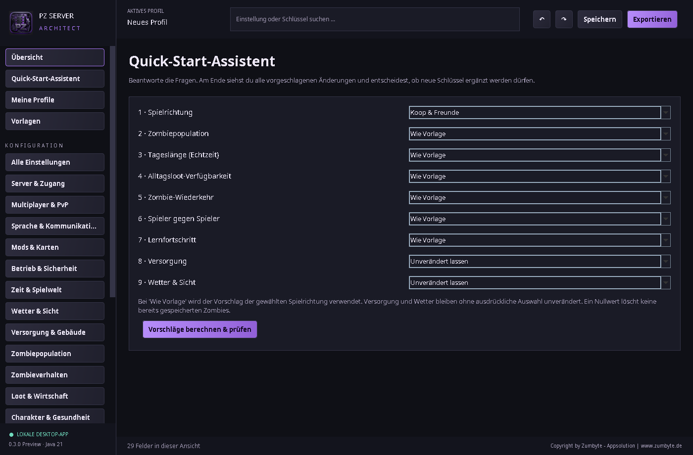

<p align="center">
  
</p>

<h1 align="center">PZ Server Architect</h1>

<p align="center">
  Dein Project-Zomboid-Server. Deine Regeln.<br>
  Ein lokaler Desktop-Konfigurator mit verständlichen Werte-Hilfen, Profilen und Quick Start.
</p>

<p align="center">
  <a href="https://github.com/ZUMBYTE-AppSolution/ruhrpottz-serverconfig-tool/releases"><strong>📦 Veröffentlichungen</strong></a>
  · <a href="src/main/resources/HANDBUCH.md">📖 Handbuch</a>
  · <a href="CHANGELOG.md">📝 Changelog</a>
  · <a href="https://github.com/ZUMBYTE-AppSolution/ruhrpottz-serverconfig-tool/issues">🛟 Fehler melden</a>
</p>

<p align="center">
  
  
  
</p>

> [!IMPORTANT]
> **0.3.0 ist eine Desktop-Preview, kein freigegebenes stabiles Release.** Die Java-App und Linux-x64-Pakete wurden lokal gebaut und geprüft. Die Windows-/macOS-Buildkette ist vorbereitet; deren echte Paket-/GUI-Tests und neue GitHub-CI-Ergebnisse sind getrennt nachzuweisen. Ein Commit allein veröffentlicht keinen Installer. Die Release-Seite kann deshalb noch leer sein.

<p align="center">
  
</p>

## ✨ Was PZ Server Architect ausmacht

Die App richtet sich an **Koop-, PvE-, PvP-, Survival- und Roleplay-Server**. Zombies sind ein normaler Einstellungsbereich, kein fest vorgeschriebenes Spielkonzept. Es gibt weder ein eingebranntes RuhrpottZ-Profil noch einen Zwang zur zombiefreien Welt.

| Bereich | Was die Preview bietet |
|---|---|
| **Einstellungen verstehen** | 360 Katalogeinträge in 17 Bereichen sowie eingelesene Modfelder. Technische Schlüssel, bekannte Werte, Einheiten, Grenzen und importierte Originalkommentare. |
| **Passende Bedienung** | Toggle-Switches für echte Booleans und dokumentierte 0/1-Schalter, Dropdowns für bekannte Stufen und validierte Zahlen-/Textfelder. Fehlend ist nicht gleich Aus. |
| **Schnell einsteigen** | Neun Fragen im Quick Start, acht allgemeine Vorlagen und eine Änderungsvorschau vor jeder Übernahme. |
| **Profile verwalten** | Speichern, öffnen, kopieren, umbenennen, löschen und wiederherstellen. Zehn ältere Fassungen je Profil, Papierkorb und JSON-Import/-Export. |
| **Kontrolliert bearbeiten** | Suche, Filter, Favoriten, Originalvergleich und bis zu 40 Undo-/Redo-Schritte im Arbeitsbereich. |
| **Dateien erhalten** | INI und eingeschränkte Sandbox-Lua-Datensyntax ohne Codeausführung einlesen; unterstützte Kommentare und Reihenfolgen bleiben erhalten. |
| **Sicher exportieren** | Ein neues Server-ZIP statt direkter Änderungen an der laufenden Serverinstallation. Erkannte Geheimnisfelder werden nicht regulär im Profil gespeichert. |
| **Updates über GitHub** | Startprüfung, optional automatischer verifizierter Download, Changelog und gesonderte Installationsaktion. Kein Masterserver, kein Endnutzer-Token. |

Die Oberfläche ist eine **Java-Swing-Desktop-App**, keine HTML-Datei und kein eingebetteter Browser. JavaFX ist in diesem Stand keine Abhängigkeit. Das vorhandene Graphit-Lila-Design, die Skalierung und das PZ-App-Icon bleiben erhalten.

### Werte statt Zahlenrätsel

Ein Schalter zeigt **Ein/Aus**, speichert aber weiterhin die richtige technische Darstellung, zum Beispiel `PVP=true` beziehungsweise `PVP=false`. Ein beliebiges Zahlenfeld wird nicht zum Schalter, nur weil darin aktuell `0` oder `1` steht. Bekannte Auswahlstufen stehen im Dropdown; ein fehlender Wert bleibt als eigener Zustand erkennbar.

> [!NOTE]
> Der Katalog stammt aus dem bisherigen Build-42-Editor. Nicht jede Grenze und Stufenwirkung ist für jeden Spielbuild vollständig verifiziert. Unbekannte Modwirkungen werden nicht erfunden. Importierte Originalkommentare und ein Test mit deinem tatsächlichen Spielbuild bleiben maßgeblich.


## 🧭 Quick Start und Vorlagen

Der Assistent verbindet neun Fragen mit einer überprüfbaren Änderungsvorschau. Vorschläge werden erst nach deiner Übernahme angewendet. Serverzugang, Workshop-IDs und Kartenreihenfolgen werden nicht durch beliebige Vorgaben ersetzt.

| Vorlage | Ausrichtung |
|---|---|
| Koop & Freunde | Gemeinsames Spielen mit weniger Druck und moderater Population. |
| PvE Community | Zusammen überleben und Nachschub kontrollieren. |
| Survival ausgewogen | Überleben mit knapperen Ressourcen. |
| Hardcore Survival | Mehr Bedrohung und weniger Komfort. |
| PvP Survival | Spielerkonflikte und Zombies; Serverregeln bleiben notwendig. |
| Roleplay mit Zombies | Längere Tage und reduzierte Population. |
| Ziviles Roleplay | Keine reguläre Zombiepopulation; entfernt keine vorhandenen Zombies. |
| Bauen & Testen | Zombiefreie Testwelt; kein automatischer Godmode oder Adminzugang. |



## 🚀 Starten und konfigurieren

### Java-Ausgabe

Ein gebautes Java-App-Paket vollständig entpacken und den passenden Starter öffnen:

| System | Starter | Voraussetzung |
|---|---|---|
| Windows | `START-Windows.cmd` | Java 21 oder neuer mit Desktop-Unterstützung. |
| macOS | `START-macOS.command` | Java 21 oder neuer mit Desktop-Unterstützung. |
| Linux | `START-Linux.sh` | Java 21 oder neuer mit Desktop-Unterstützung. |

Alternativ im entpackten Paket:

```sh
java -jar PZ-Server-Architect-0.3.0.jar
```

### Native Pakete

Native App-Pakete enthalten ihre Java-Laufzeit. Lokal vorhanden: Linux x64, auf Debian 13 gebaut. Eine portable Ausgabe muss **vollständig** entpackt werden; die Launcherdatei allein reicht nicht aus. Die Windows-/macOS-Ausgaben dürfen erst als erhältlich bezeichnet werden, sobald passende geprüfte Assets wirklich auf der Release-Seite stehen.

### Der erste Arbeitsablauf

1. Die zusammengehörigen `<servername>.ini` und `<servername>_SandboxVars.lua` importieren oder mit dem Assistenten beginnen.
2. Werte beziehungsweise eine Vorlage auswählen, Änderungen prüfen und ein eigenes Profil speichern.
3. Ein neues Server-ZIP exportieren. Erst nach Backup bei gestopptem Server bewusst übernehmen.

AMP kann Dateien beim Start mit eigenen Panelwerten überschreiben. Die App greift nicht direkt auf AMP, SSH oder deine laufende Welt zu. Sie löscht keine Saves oder bestehenden Zombies und erzwingt keine clientseitige Renderdistanz.

## 🔄 Updates ohne eigenen Server

Die Updatequelle ist ausschließlich dieses öffentliche GitHub-Repository. Bei einer neueren **stabilen App-Version** kann die Anwendung das zum Betriebssystem und zur CPU passende Paket automatisch laden. Dateigröße und GitHubs SHA-256-Digest werden geprüft; vor einer ausdrücklich ausgelösten Installation wird erneut geprüft.

Entwürfe, Vorabversionen, SDK-Pakete, einzelne Commits und reine Git-Tags sind keine regulären App-Updates. Offlinebetrieb und erkannte Abfragelimits werden nicht als erfolgreicher „aktuell“-Check ausgegeben. **Heruntergeladen bedeutet nicht installiert.** Kein stiller Neustart, kein Umgehen von UAC oder Gatekeeper, kein fertiger Rollbackmechanismus.

Die derzeitige Windows-CI baut eine portable Ausgabe, noch keine MSI. Diese portable ZIP ist kein automatisches Installerpaket. Der vollständige Live-Update-/Installationszyklus bleibt vor einer stabilen Freigabe zu testen. Details: [Updater](docs/UPDATER.md), [Releases](docs/RELEASES.md).

## 🔐 Lokal, nachvollziehbar, ohne Konfigurations-Upload

Profile und Arbeitsdaten bleiben lokal. Der Updater lädt keine Serverdateien oder Kennwörter hoch; der Serverstatus wird nur nach Klick von der festgelegten öffentlichen Serverlistenseite abgerufen. Es gibt keine Telemetrie oder Werbetracker.

Erkannte Passwort-/Tokenfelder werden beim normalen Profilspeichern entfernt. Beim späteren nativen Export müssen sie bewusst ergänzt oder geleert werden. Ein OS-Passworttresor ist noch nicht eingebaut. Freie Kommentare und Notizen werden nicht garantiert bereinigt. **Native Export-ZIPs enthalten die tatsächlichen Werte und gegebenenfalls Kennwörter.** Vor dem Teilen kontrollieren.

Profilhistorie und Papierkorb ersetzen kein unabhängiges Backup. Mehr zu Parsergrenzen, lokalen Angreifern und Prüfsummen: [SECURITY.md](SECURITY.md).

## 🟣 Community-Tipp: RuhrpottZ

**RuhrpottZ · German ZomboID Roleplay Project**

[Öffentlichen Servereintrag ansehen](https://pzservers.net/server/75212135) · **Discord folgt.**

Die Empfehlung ist von deinen eigenen Serverprofilen getrennt. Keine fest einprogrammierte Spielerzahl, kein erfundener Live-Status und keine frei erfundene Discord-Einladung. Der Statusparser ist bislang mit Testdaten geprüft, nicht durch einen nachgewiesenen erfolgreichen Liveabruf.

## 🧪 Entwicklungs- und Prüfstand

| Prüfung | Belegter Umfang |
|---|---|
| Java-Kompilierung | Java 21, `--release 21 -Xlint:all -Werror`, lokal unter Linux. |
| Editor/Parser/Profile | 941 automatisierte Offline-Assertions. |
| GitHub-Updater | 128 automatisierte Offline-Assertions. |
| Oberfläche | 31 GUI-Prüfschritte mit tatsächlich geöffnetem Swing-Fenster unter Linux/Xvfb. |
| Linux-Paket | Bereits lokal gebaut; entpackter DEB-Launcher mit enthaltener Laufzeit gestartet. Keine systemweite Paketinstallation. |
| Windows/macOS, Spielbetrieb | Nicht durch den lokalen Linux-Lauf belegt. |

Der aktuelle Nachweis steht in [Prüfstatus](docs/TESTSTATUS.md). Frühere erfolgreiche SDK-CI-Läufe beweisen nicht die neue Desktop-App. Screenshots sind echte lokale Programmdarstellungen, keine Design-Mockups.

Noch offen: Tags, Sammelbackup aller Profile, Vergleich zweier beliebiger Profile, OS-Geheimnisspeicher, vollständige Buildmigration, Code-Signing/Notarisierung und native Plattform-/Spieltests. Die [Roadmap](ROADMAP.md) trennt diese Arbeiten vom implementierten Umfang.

## 🛠️ Aus dem Quellcode bauen

Benötigt werden **JDK 21 oder neuer und Python 3**. Es werden keine externen Java-Bibliotheken oder mitgelieferten Schriftdateien benötigt.

```sh
python tools/build.py
java -jar build/PZ-Server-Architect-0.3.0.jar
python tools/package.py
# Optionaler Installer, nur auf dem jeweiligen Zielsystem:
python tools/package.py --installer
```

`jpackage` ist kein Cross-Compiler. Die Plattformpakete werden auf dem jeweiligen Betriebssystem erstellt. Für Windows-MSI ist eine kompatible WiX-Installation nötig; der portable Windows-Build benötigt sie nicht. Nach erneuter Paketierung alte Buildausgaben bewusst zur Seite legen, da vorhandene Pakete nicht still überschrieben werden.

Die CI- und Draft-Release-Workflows liegen unter `.github/workflows`. Ein Commit startet gegebenenfalls CI, veröffentlicht aber kein stabiles App-Release. Siehe [Release-Ablauf](docs/RELEASES.md) und [Entwicklung](CONTRIBUTING.md).

## 💬 Support und Dokumentation

[Handbuch](src/main/resources/HANDBUCH.md) · [Changelog](CHANGELOG.md) · [Support](SUPPORT.md) · [Sicherheit](SECURITY.md) · [Zumbyte](https://www.zumbyte.de/)

Fehlerberichte bitte mit App-Version, Betriebssystem/Architektur, Spielbuild und reproduzierbaren Schritten. Keine echten Serverkennwörter, Tokens oder unbereinigten Profile in öffentlichen Issues.

## ⚖️ Hinweise

PZ Server Architect ist ein eigenständiges Projekt von **Zumbyte - Appsolution**. Keine Verbindung zu The Indie Stone. Project Zomboid und andere Produktnamen gehören ihren jeweiligen Rechteinhabern. Ein öffentliches Repository gewährt nicht automatisch eine Open-Source-Lizenz; in diesem Stand ist keine gesonderte Nutzungslizenz beigefügt.

<p align="center"><strong>Copyright by Zumbyte - Appsolution | <a href="https://www.zumbyte.de/">www.zumbyte.de</a></strong></p>
