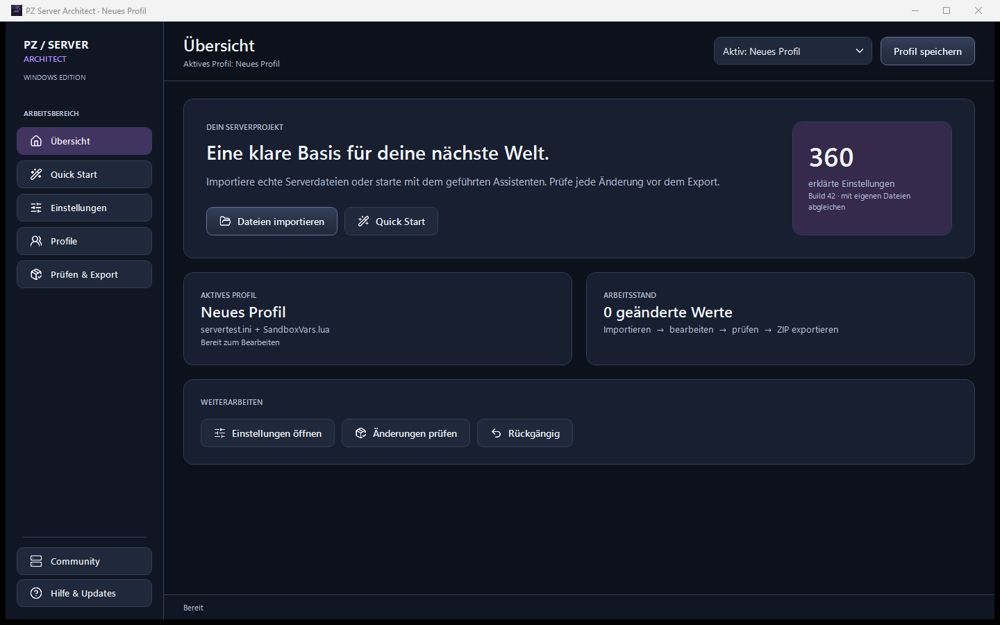
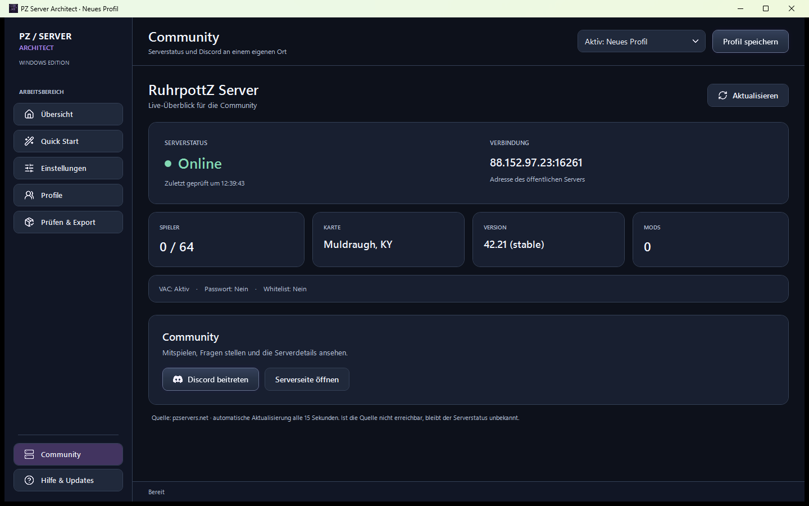
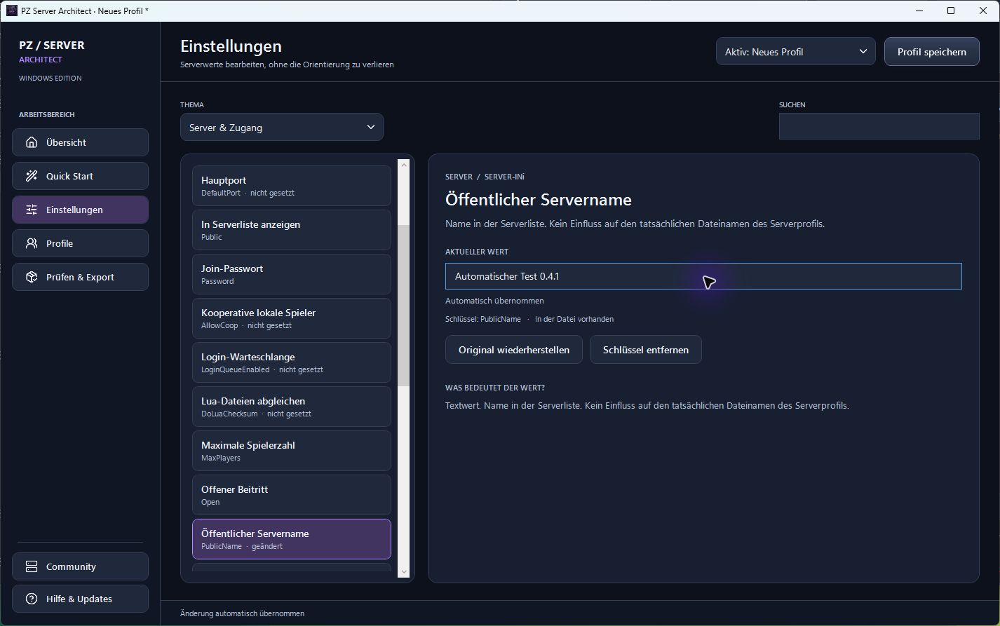
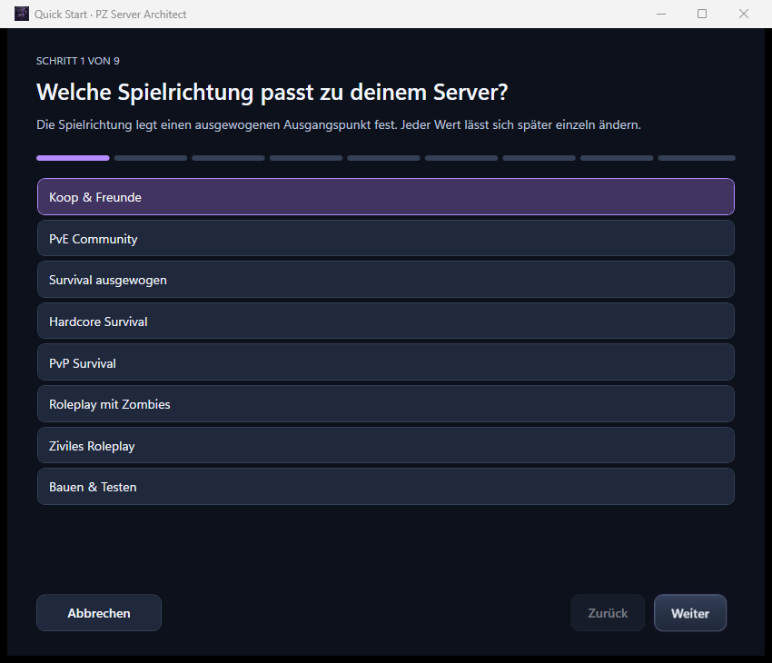

<p align="center"></p>
<h1 align="center">PZ Server Architect</h1>
<p align="center">Dein Project-Zomboid-Server. Deine Regeln.<br>Ein lokaler Konfigurator für verständliche Serverwerte, Profile und einen sicheren Export.</p>

<p align="center">
  <a href="https://github.com/ZUMBYTE-AppSolution/ruhrpottz-serverconfig-tool/releases/download/v0.4.0/PZ-Server-Architect-0.4.0-windows-x64.msi"><strong>Windows installieren</strong></a>
  · <a href="https://github.com/ZUMBYTE-AppSolution/ruhrpottz-serverconfig-tool/releases/download/v0.4.0/PZ-Server-Architect-0.4.0-windows-x64-portable.zip">Windows portabel</a>
  · <a href="https://github.com/ZUMBYTE-AppSolution/ruhrpottz-serverconfig-tool/releases/tag/v0.4.0">Alle Plattformen</a>
</p>
<p align="center">
  <a href="https://github.com/ZUMBYTE-AppSolution/ruhrpottz-serverconfig-tool/releases"></a>
  <a href="https://github.com/ZUMBYTE-AppSolution/ruhrpottz-serverconfig-tool/actions/workflows/ci.yml"></a>
  <a href="CHANGELOG.md"></a>
</p>

> **v0.4.0 Preview:** Native WPF-Oberfläche für Windows x64; macOS Intel/Apple Silicon und Linux x64 verwenden die Java-Oberfläche. Die App arbeitet lokal und verändert keinen laufenden Server.



## Was du damit machen kannst

| Aufgabe | In der App |
|---|---|
| **Schnell starten** | Eigenes Assistentenfenster mit neun erklärten Schritten, Zurück/Weiter und Änderungsvorschau. |
| **Werte verstehen** | 360 erklärte Katalogeinträge in 17 Bereichen sowie importierte Modfelder. |
| **Gezielt bearbeiten** | Suche, Themenauswahl, passende Eingaben und Auswahlfelder, Undo und Redo. |
| **Profile behalten** | Oben direkt wechseln oder neu anlegen; lokal speichern, kopieren, umbenennen, wiederherstellen und als JSON übertragen. |
| **Dateien sicher übernehmen** | INI und Sandbox-Lua importieren, prüfen und als neues ZIP exportieren. |
| **Updates finden** | GitHub-Releases prüfen und passende Pakete nach Prüfsummenvergleich laden. |
| **Community besuchen** | RuhrpottZ-Status beim Öffnen und alle 15 Sekunden abrufen; Discord über einen eigenen Button öffnen. |

Es gibt keinen Masterserver, keine Telemetrie und keinen Upload deiner Serverkonfiguration. Der RuhrpottZ-Eintrag liest eine öffentliche Serverliste und bleibt getrennt von deinen Profilen.



## Installation

1. Lade das passende Paket von [v0.4.0 Preview](https://github.com/ZUMBYTE-AppSolution/ruhrpottz-serverconfig-tool/releases/tag/v0.4.0). Windows bietet MSI und ein portables ZIP, macOS je ein DMG für Intel und Apple Silicon, Linux ein DEB und ein portables TAR.GZ.
2. Bei einem portablen Paket: **vollständig entpacken**, dann den enthaltenen App-Starter öffnen. Unter Windows heißt er `PZServerArchitect.exe`. Die benötigten Laufzeiten sind enthalten.
3. Importiere dein zusammengehöriges `.ini`- und `_SandboxVars.lua`-Dateipaar oder beginne mit Quick Start.
4. Prüfe die Änderungen und exportiere ein neues ZIP. Übernimm es erst nach einem Backup und einem Test mit deinem Spielbuild und deinen Mods.

Das zusätzliche MSIX-Testpaket ist **nicht signiert** und verwendet eine Entwicklungsidentität. Für eine Store-Abgabe fehlen noch die Reservierung und Paketidentität aus Microsoft Partner Center. Zum direkten Ausprobieren unter Windows das portable ZIP verwenden. [MSIX-Stand](docs/RELEASES.md)





## Hinweise zu deinen Daten

Profile bleiben auf deinem Gerät. Erkannte Passwortfelder werden beim normalen Profilspeichern nicht dauerhaft übernommen. Ein exportiertes Server-ZIP kann dennoch echte Zugangsdaten enthalten; prüfe es vor dem Teilen. Die App führt kein Lua aus, ändert keine Savegames und startet keine Server neu. Details stehen im [Handbuch](src/main/resources/HANDBUCH.md) und in [Sicherheit](SECURITY.md).

Der Katalog hilft bei der Bedienung, ersetzt aber keinen Test mit deiner konkreten Project-Zomboid-Version und Modkombination. AMP kann Werte beim Serverstart überschreiben.

## Entwicklungsstand

Für v0.4.0 wurde die Windows-Oberfläche als WPF-App neu umgesetzt. Der [öffentliche Release-Lauf](https://github.com/ZUMBYTE-AppSolution/ruhrpottz-serverconfig-tool/actions/runs/38968291434) bestand auf allen vier Plattformen und veröffentlichte [v0.4.0 Preview](https://github.com/ZUMBYTE-AppSolution/ruhrpottz-serverconfig-tool/releases/tag/v0.4.0). Alle neun Pakete und ihre Prüfsummen wurden überprüft. Bestätigte Ergebnisse und offene Punkte stehen in [Prüfstatus](docs/TESTSTATUS.md) und [Changelog](CHANGELOG.md).

Für Entwicklung werden JDK 21 und Python 3 benötigt:

```sh
python tools/build.py
python tools/package_wpf.py --installer  # Windows mit .NET 10 und WiX
python tools/package.py --installer      # macOS oder Linux
```

Die Pakete werden jeweils auf ihrem Zielbetriebssystem erstellt. GitHub Actions baut Windows, macOS und Linux automatisch; ein Versionstag auf `main` erstellt erst nach vollständiger Paket- und SHA-256-Prüfung ein Release. Der private Entwicklungsstand liegt in einem separaten Repository mit Branch `test`, weil GitHub keine privaten Branches innerhalb eines öffentlichen Repositorys anbietet. [Release-Ablauf](docs/RELEASES.md) · [Mitwirken](CONTRIBUTING.md)

## Hilfe und Kontakt

[Handbuch](src/main/resources/HANDBUCH.md) · [Probleme melden](https://github.com/ZUMBYTE-AppSolution/ruhrpottz-serverconfig-tool/issues) · [Support](SUPPORT.md) · [Zumbyte](https://www.zumbyte.de/)

PZ Server Architect ist ein eigenständiges Projekt von Zumbyte - Appsolution und steht nicht in Verbindung mit The Indie Stone. Die Veröffentlichung des Quellcodes erteilt derzeit keine zusätzliche Nutzungslizenz.
